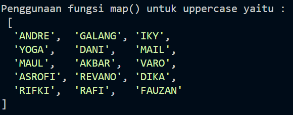
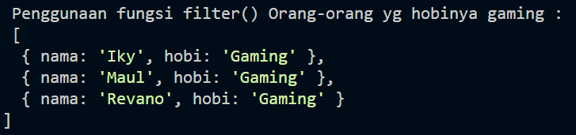
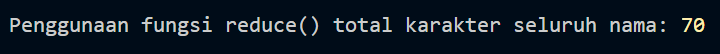
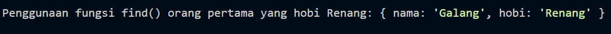
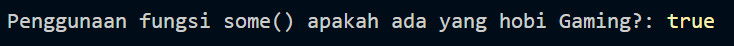
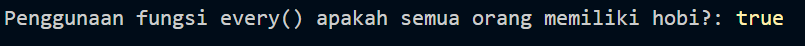

# Tugas 2 - Eksplorasi Array Function JavaScript

## Profil

| Keterangan | Informasi                 |
| ---------- | ------------------------- |
| Nama       | FAUZAN HARI RAMDANI       |
| NIM        | F1D02410047               |
| Topik      | Array Function JavaScript |

---

## Gambaran Tugas

Pada tugas ini saya mencoba menggunakan beberapa fungsi bawaan JavaScript untuk mengolah sekumpulan data sederhana.

Data yang digunakan berisi nama seseorang beserta hobinya. Terdapat 15 data dengan beberapa hobi yang sama, seperti Lari, Renang, Gaming, Bulutangkis, dan Main Bola.

Pemilihan data nama dan hobi dilakukan agar setiap fungsi Array dapat digunakan pada kondisi yang berbeda. Dengan demikian, hasil dari setiap metode dapat dibandingkan secara langsung.

### Data yang digunakan

```javascript
const dataHobi = [
  { nama: "Andre", hobi: "Lari" },
  { nama: "Galang", hobi: "Renang" },
  { nama: "Iky", hobi: "Gaming" },
  { nama: "Yoga", hobi: "Bulutangkis" },
  { nama: "Dani", hobi: "Main Bola" },
  { nama: "Mail", hobi: "Lari" },
  { nama: "Maul", hobi: "Gaming" },
  { nama: "Akbar", hobi: "Renang" },
  { nama: "Varo", hobi: "Bulutangkis" },
  { nama: "Asrofi", hobi: "Main Bola" },
  { nama: "Revano", hobi: "Gaming" },
  { nama: "Dika", hobi: "Lari" },
  { nama: "Rifki", hobi: "Main Bola" },
  { nama: "Rafi", hobi: "Renang" },
  { nama: "Fauzan", hobi: "Bulutangkis" },
];
```

---

# Percobaan Array Function

## 01. Mengubah Nama dengan `map()`

`map()` saya gunakan ketika ingin menghasilkan bentuk baru dari seluruh data tanpa mengubah array awal.

Dalam percobaan ini, setiap nama diubah menjadi huruf kapital menggunakan `toUpperCase()`.

```javascript
const namaHurufBesar = dataHobi.map((orang) => orang.nama.toUpperCase());

console.log("\nPenggunaan fungsi map() untuk uppercase:\n", namaHurufBesar);
```

Output yang diperoleh berupa daftar nama dalam huruf kapital, misalnya:

```text
[
  "ANDRE",
  "GALANG",
  "IKY",
  "YOGA",
  "DANI",
  "MAIL",
  "MAUL",
  "AKBAR",
  "VARO",
  "ASROFI",
  "REVANO",
  "DIKA",
  "RIFKI",
  "RAFI",
  "FAUZAN"
]
```

**Dokumentasi:**  


---

## 02. Menemukan Kelompok Hobi Gaming dengan `filter()`

Pada bagian ini saya ingin mendapatkan seluruh data yang memiliki hobi Gaming.

Karena kemungkinan terdapat lebih dari satu orang dengan hobi yang sama, `filter()` digunakan untuk mengambil semua data yang memenuhi kondisi tersebut.

```javascript
const hobiGaming = dataHobi.filter((orang) => orang.hobi === "Gaming");

console.log(
  "\nPenggunaan fungsi filter() orang yang hobinya Gaming:\n",
  hobiGaming
);
```

Dari data yang digunakan, terdapat tiga orang yang memiliki hobi Gaming:

```text
Iky
Maul
Revano
```

**Dokumentasi:**  


---

## 03. Menghitung Karakter Nama dengan `reduce()`

Berbeda dengan `map()` dan `filter()`, kali ini hasil yang dibutuhkan bukan lagi sebuah array.

Saya menggunakan `reduce()` untuk menjumlahkan jumlah karakter dari seluruh nama yang terdapat dalam data.

```javascript
const totalKarakterNama = dataHobi.reduce((total, orang) => {
  return total + orang.nama.length;
}, 0);

console.log(
  "\nPenggunaan fungsi reduce() total karakter seluruh nama:",
  totalKarakterNama
);
```

Setiap nama akan dihitung panjangnya menggunakan `.length`, kemudian hasilnya dikumpulkan oleh `reduce()` menjadi satu nilai akhir.

**Dokumentasi:**  


---

## 04. Mengambil Data Pertama dengan `find()`

Untuk memahami `find()`, saya mencoba mencari orang pertama yang mempunyai hobi Renang.

```javascript
const orangHobiRenang = dataHobi.find((orang) => orang.hobi === "Renang");

console.log(
  "\nPenggunaan fungsi find() orang pertama yang hobi Renang:",
  orangHobiRenang
);
```

Data pertama yang memenuhi kondisi tersebut adalah:

```text
Galang - Renang
```

Walaupun terdapat beberapa orang lain dengan hobi Renang, `find()` hanya mengambil data pertama yang ditemukan.

**Dokumentasi:**  


---

## 05. Pemeriksaan Kondisi dengan `some()`

`some()` digunakan untuk menjawab pertanyaan sederhana:

> Apakah terdapat setidaknya satu orang yang memiliki hobi Gaming?

Implementasinya:

```javascript
const adaHobiGaming = dataHobi.some((orang) => orang.hobi === "Gaming");

console.log(
  "\nPenggunaan fungsi some() apakah ada yang hobi Gaming?:",
  adaHobiGaming
);
```

Output:

```text
true
```

Nilai `true` menunjukkan bahwa kondisi tersebut memang ditemukan dalam data.

**Dokumentasi:**  


---

## 06. Memeriksa Seluruh Data dengan `every()`

Percobaan terakhir menggunakan `every()`.

Kondisi yang diperiksa adalah apakah setiap orang dalam data memiliki hobi yang telah diisi.

```javascript
const semuaPunyaHobi = dataHobi.every((orang) => orang.hobi !== "");

console.log(
  "\nPenggunaan fungsi every() apakah semua orang memiliki hobi?:",
  semuaPunyaHobi
);
```

Output:

```text
true
```

Hal ini menunjukkan bahwa tidak terdapat data dengan nilai hobi kosong.

**Dokumentasi:**  


---

# Perbandingan Hasil

Dari percobaan yang dilakukan, keenam metode memberikan jenis hasil yang berbeda.

| Method     | Yang Dilakukan                              | Bentuk Hasil            |
| ---------- | ------------------------------------------- | ----------------------- |
| `map()`    | Mengubah nama menjadi huruf kapital         | Array baru              |
| `filter()` | Mengambil semua orang dengan hobi Gaming    | Array hasil penyaringan |
| `reduce()` | Menjumlahkan karakter seluruh nama          | Satu nilai              |
| `find()`   | Mencari orang pertama dengan hobi Renang    | Satu object             |
| `some()`   | Mengecek keberadaan hobi Gaming             | Boolean                 |
| `every()`  | Memeriksa apakah seluruh data memiliki hobi | Boolean                 |

---

# Kesimpulan

Percobaan ini menunjukkan bahwa metode Array tidak memiliki fungsi yang sama meskipun semuanya digunakan untuk memproses data yang berasal dari array.

`map()` lebih tepat digunakan ketika setiap elemen perlu diolah menjadi bentuk baru. `filter()` digunakan ketika hanya sebagian data yang ingin diambil berdasarkan kondisi tertentu. Sementara itu, `reduce()` dapat digunakan ketika beberapa data perlu dikumpulkan menjadi satu hasil.

Untuk pencarian, `find()` digunakan ketika data pertama yang memenuhi kondisi sudah cukup. Sedangkan `some()` dan `every()` lebih berfokus pada pemeriksaan kondisi. `some()` cukup menemukan satu data yang sesuai, sedangkan `every()` membutuhkan seluruh data memenuhi kondisi.

Melalui data nama dan hobi ini, saya dapat melihat secara langsung perbedaan cara kerja keenam metode tersebut dan memahami kapan masing-masing metode lebih sesuai digunakan.
